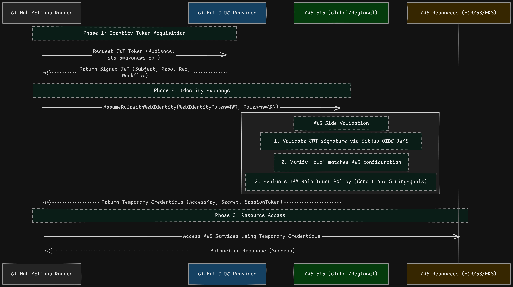

# Migrating from Long-Lived AWS Credentials to OpenID Connect (OIDC)

An architectural and operational engineering guide for replacing static, long-lived AWS IAM access keys with short-lived, cryptographically verified OpenID Connect (OIDC) tokens in CI/CD pipelines.

## Contents

- [Executive Summary](#executive-summary)
- [1. The Problem: Why Static Credentials Fail at Scale](#1-the-problem-why-static-credentials-fail-at-scale)
- [2. The Solution: OpenID Connect (OIDC)](#2-the-solution-openid-connect-oidc)
  - [Handshake Sequence](#handshake-sequence)
  - [Architecture Comparison](#architecture-comparison)
- [3. Deep Dive: The OIDC Trust Policy](#3-deep-dive-the-oidc-trust-policy)
  - [Trust Policy Schema](#trust-policy-schema)
  - [Policy Hardening Rules](#policy-hardening-rules)
- [4. Implementation Guide](#4-implementation-guide)
  - [Step 1: Configure AWS Identity Provider](#step-1-configure-aws-identity-provider)
  - [Step 2: Inspect the Exact OIDC Subject (`sub`) Claim](#step-2-inspect-the-exact-oidc-subject-sub-claim)
  - [Step 3: Configure GitHub Actions Workflow](#step-3-configure-github-actions-workflow)
- [5. Troubleshooting & Diagnostic Matrix](#5-troubleshooting--diagnostic-matrix)
- [6. Summary of Security Improvements](#6-summary-of-security-improvements)

---

## Objectives and Security Benefits

Historically, continuous deployment pipelines authenticated to AWS using static, long-lived IAM User Access Keys (`AWS_ACCESS_KEY_ID` and `AWS_SECRET_ACCESS_KEY`) stored as GitHub Actions Secrets. This pattern exposes platforms to credential leakage, key rotation fatigue, and unchecked privilege creep.

This specification details the architecture, configuration, and security rationale for migrating our deployment pipeline to **OpenID Connect (OIDC)**. By establishing trust between GitHub Actions and **AWS Security Token Service (STS)**, we eliminate static secrets entirely, issuing temporary, short-lived session credentials scoped strictly to approved repositories, workflows, and branches.

---

## 1. The Problem: Why Static Credentials Fail at Scale

Evaluating static credentials against the **CIA Triad** (Confidentiality, Integrity, Availability) reveals fundamental operational and security flaws:

* **Unbounded Blast Radius:** If a developer machine is compromised, a secret-leaking log is committed, or a malicious dependency runs in a runner, static keys can be exfiltrated. Because they have no automatic expiration, attackers have an indefinite window to exploit them.
* **Rotation Fatigue & Fragility:** Manual rotation across distributed repositories, environments, and team workflows is error-prone and frequently neglected. Automating rotation requires giving the rotation engine elevated IAM permissions, creating a single high-value target.
* **Coarse CloudTrail Auditability:** When a static key is exercised, AWS CloudTrail attributes events solely to the parent IAM User. It cannot identify which GitHub Actions workflow, run ID, commit SHA, or actor initiated the API call.
* **Credential Sprawl:** Static keys are frequently copied into local `.env` files or staging systems during development, breaking least-privilege principles and expanding the attack surface.

---

## 2. The Solution: OpenID Connect (OIDC)

OpenID Connect (OIDC) is an identity layer built on OAuth 2.0. Rather than storing permanent passwords, GitHub acts as an Identity Provider (IdP) that issues signed JSON Web Tokens (JWTs). AWS STS verifies these tokens against GitHub's public JSON Web Key Sets (JWKS) before exchanging them for temporary IAM session credentials.

### Handshake Sequence



### Architecture Comparison

| Feature | Static IAM User Keys | AWS OIDC Web Identity |
| :--- | :--- | :--- |
| **Credential Lifespan** | Indefinite (requires manual revocation) | 1 Hour (automatic TTL expiration) |
| **Secret Storage** | Stored in GitHub Secrets store | Never stored; generated ephemerally in runner RAM |
| **Blast Radius** | Broad; persistent access until revoked | Minimal; time-bound and branch-bound |
| **Authentication Factor** | Shared secret (*something you have*) | Cryptographic identity proof (*something you are*) |
| **CloudTrail Audit** | Generic IAM User ARN | Specific repo, Git ref, commit SHA, and workflow job |

---

## 3. Deep Dive: The OIDC Trust Policy

The core security control is the **IAM Role Trust Policy**, which establishes who is allowed to assume the role.

> **Note on Subject (`sub`) Claims:**  
> GitHub accounts and repositories may format subject claims using immutable identifier tokens (`repo:<org>@<org_id>/<repo>@<repo_id>:...`). Always extract the raw token using the diagnostic workflow in Step 2 to guarantee exact condition matching.

### Trust Policy Schema

```json
{
  "Version": "2012-10-17",
  "Statement": [
    {
      "Effect": "Allow",
      "Principal": {
        "Federated": "arn:aws:iam::<YOUR_AWS_ACCOUNT_ID>:oidc-provider/token.actions.githubusercontent.com"
      },
      "Action": "sts:AssumeRoleWithWebIdentity",
      "Condition": {
        "StringEquals": {
          "token.actions.githubusercontent.com:aud": "sts.amazonaws.com",
          "token.actions.githubusercontent.com:sub": "repo:durgax04/chat-with-pdf:ref:refs/heads/master"
        }
      }
    }
  ]
}
```

### Policy Hardening Rules

1. **Explicit Branch Pinning:** Lock the `sub` claim to target deployment branches (e.g., `ref:refs/heads/master`). If branches are unpinned, any contributor on a feature branch or fork can trigger a workflow that assumes production credentials.
2. **Restrictive Audience:** Enforce `aud: "sts.amazonaws.com"` to verify the token was generated specifically for AWS STS and prevent token reuse across other services.
3. **Avoid Overbroad Wildcards:** Avoid using unconditional `repo:durgax04/*` wildcards in production deployment roles. Restrict roles to specific target repositories.

---

## 4. How I implemented 

### Step 1: Configure AWS Identity Provider

1. Open **AWS IAM** $\rightarrow$ **Identity Providers** $\rightarrow$ **Add Provider**.
2. Select **OpenID Connect**.
3. Set **Provider URL**: `https://token.actions.githubusercontent.com`.
5. Set **Audience**: `sts.amazonaws.com`.
6. Click **Add provider**.

### Step 2: Inspect the Exact OIDC Subject (`sub`) Claim

To eliminate mismatches caused by casing, branch prefixes, or account identifiers, run this temporary inspection step in a workflow run:

```yaml
- name: Inspect OIDC Subject Claim
  run: |
    RAW_TOKEN=$(curl -sH "Authorization: bearer $ACTIONS_ID_TOKEN_REQUEST_TOKEN" \
      "$ACTIONS_ID_TOKEN_REQUEST_URL&audience=sts.amazonaws.com" | jq -r '.value')
    echo "Decoded sub claim:"
    echo "$RAW_TOKEN" | cut -d. -f2 | base64 -d 2>/dev/null | jq -r '.sub'
```

Copy the output string directly into the `token.actions.githubusercontent.com:sub` condition of your IAM Role trust policy.

### Step 3: Configure GitHub Actions Workflow

Ensure `permissions` grants `id-token: write` so the runner can negotiate the JWT with GitHub's auth service:

```yaml
name: Build and Deploy

on:
  push:
    branches:
      - master

permissions:
  id-token: write  # Mandatory for STS Web Identity token acquisition
  contents: read   # Required to checkout repository code

jobs:
  build_and_deploy:
    runs-on: ubuntu-latest
    steps:
      - name: Checkout repository
        uses: actions/checkout@v4

      - name: Configure AWS Credentials via OIDC
        uses: aws-actions/configure-aws-credentials@v4
        with:
          role-to-assume: arn:aws:iam::<YOUR_AWS_ACCOUNT_ID>:role/github-actions-ecr-deploy-role
          role-session-name: GitHubActionsECRPush
          aws-region: us-east-1
          audience: sts.amazonaws.com

      - name: Login to Amazon ECR
        id: login-ecr
        uses: aws-actions/amazon-ecr-login@v2

      # Continue with Docker build and deployment operations...
```

---

## 5. Troubleshooting & Diagnostic Matrix

| Error Message / Symptom | Root Cause | Resolution |
| :--- | :--- | :--- |
| `Not authorized to perform sts:AssumeRoleWithWebIdentity` | `sub` claim condition mismatch between the GitHub JWT and IAM Trust Policy. | Verify exact repository path, casing, and branch name (`ref:refs/heads/<branch>`). Run the token debug step from Step 2 to verify string identity. |
| `Not authorized to perform sts:AssumeRoleWithWebIdentity` | Audience (`aud`) mismatch or missing from IAM Identity Provider configuration. | Verify that `sts.amazonaws.com` is registered under the Client IDs in the IAM Identity Provider and asserted in the trust policy condition. |
| `Could not resolve host: token.actions.githubusercontent.com` | Runner networking or DNS resolution failure. | Ensure GitHub-hosted runners have unrestricted outbound access to port 443. |
| `fatal: could not read Username for 'https://github.com'` | Workflow attempted to clone or push to another Git repo using AWS credentials. | OIDC credentials authenticate AWS STS exclusively. Cross-repository Git operations require a dedicated Personal Access Token (`PAT`) or GitHub App installation token. |

---

## 6. Summary of Security Improvements

* **Zero Static Secrets:** No AWS access keys or secrets reside in GitHub repository settings, eliminating the risk of credential scraping from logs or compromised environments.
* **Ephemeral Scope:** Temporary credentials expire automatically after 1 hour, cutting off persistent attacker access if a build container is compromised.
* **Precise Audit Trails:** CloudTrail logs trace each request back to the exact GitHub repository, workflow run ID, actor, and commit SHA.
* **Cryptographic Attestation:** Authentication shifts from shared strings to cryptographically signed identity assertions validated directly against AWS trust roots.